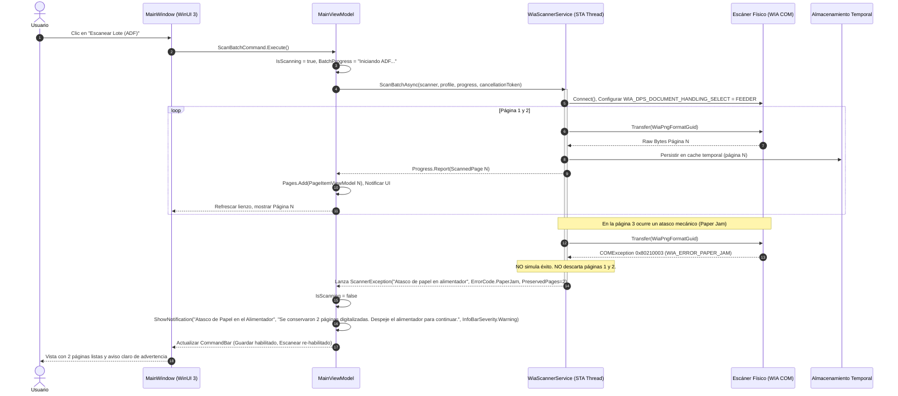

# Auditoría Comparativa, Arquitectura y Plan de Evolución: WinSimpleScan vs. GNOME Document Scanner 50.0

> **Fecha:** 2026-11-01  
> **Proyecto Base:** `Simple-WinScan` ([https://github.com/ARELL31/Simple-WinScan](https://github.com/ARELL31/Simple-WinScan)) — Rama: `main` | Commit: `a355bde846b170bce0afab48e26161b9de5ed3be`  
> **Referencia Funcional:** `GNOME Document Scanner (simple-scan)` ([https://gitlab.gnome.org/GNOME/simple-scan/-/tree/50.0](https://gitlab.gnome.org/GNOME/simple-scan/-/tree/50.0)) — Etiqueta: `50.0` | Commit: `d3de664860c6a5e9ec477b127dab82539f2cf184`  
> **Harness & Metodología:** GitHub Superpowers + UI/UX Pro Max Design Intelligence  
> **Plataforma Objetivo:** Windows 11 / Windows 10 (x64) con WinUI 3 (Windows App SDK 2.6.4) y C# (.NET 8.0)

---

## 1. Auditoría Comparativa de Proyectos

### 1.1 Contexto y Discrepancias entre Especificación y Código Real

En la auditoría inicial de [`docs/superpowers/plans/2026-11-01-winsimplescan-architecture.md`](file:///C:/Users/cabez/source/repos/Simple-WinScan/docs/superpowers/plans/2026-11-01-winsimplescan-architecture.md), se identificaron varias diferencias entre lo proyectado y lo implementado:
1. **Lienzo de Páginas:** La especificación proponía `ItemsRepeater` con scroll vertical; en la práctica se implementó un `ItemsControl` con `StackPanel Orientation="Horizontal"`, lo cual limita la experiencia a una tira horizontal sin soporte para cuadrícula responsiva (Wrap) ni virtualización de elementos para documentos de cientos de páginas.
2. **Selector de Escáner y Perfiles:** La especificación proponía integración completa de perfiles configurables; en el código sólo existen dos instancias estáticas en memoria (`ScanProfile.TextDefault` y `PhotoDefault`) sin persistencia ni posibilidad de ajustar resolución, brillo, contraste o tamaño de papel.
3. **Manejo de Errores de Hardware:** En [`WiaScannerService.cs`](file:///C:/Users/cabez/source/repos/Simple-WinScan/Simple-WinScan/Services/Implementations/WiaScannerService.cs#L170-L174), ante cualquier fallo físico durante la captura, el bloque `catch (Exception) when (!cancellationToken.IsCancellationRequested)` intercepta la excepción del dispositivo y **retorna silenciosamente una página sintética generada en memoria** (`GenerateMockPageInternal`). Como resultado, la UI informa falsamente que la digitalización fue un éxito (`"Página digitalizada con éxito"`), ocultando al usuario errores críticos como alimentador atascado, lámpara bloqueada o desconexión del cable.
4. **Verificación sobre OCR en GNOME 50.0:** El análisis riguroso del código fuente de GNOME Simple Scan 50.0 revela que **no posee motor de OCR integrado en C/Vala ni genera PDF con texto buscable de forma nativa**. Delega esto opcionalmente a un script externo bash ([`src/simple-scan-postprocessing.sh`](file:///C:/Users/cabez/.gemini/antigravity-cli/brain/b5d71521-74e8-4b18-999f-6a82a40c15cd/scratch/gnome-simple-scan-50.0/src/simple-scan-postprocessing.sh#L6-L19)) invocando `ocrmypdf`. Para Windows, la oportunidad real es utilizar de forma nativa la API de OCR de Windows (`Windows.Media.Ocr.OcrEngine`) sin requerir Docker ni scripts de Linux.

---

### 1.2 Matriz de Auditoría de Comportamientos (10 Familias)

Estados posibles:
- **Completo:** La funcionalidad está plenamente implementada, vinculada a la UI y probada.
- **Parcial:** Existe parte de la infraestructura pero carece de controles, opciones o manejo de casos borde.
- **Ausente:** No existe soporte ni en UI ni en capa de servicio.
- **No verificable:** Requiere un modelo de hardware físico específico no disponible en el entorno actual.
- **No aplicable:** Característica exclusiva del ecosistema Linux/SANE sin sentido en Windows (se documenta su equivalente Windows).

| ID | Comportamiento | Evidencia GNOME (50.0) | Ruta y Símbolo en Simple-WinScan | Estado | Cómo se comprobó | Brecha o Decisión | Issue |
| :--- | :--- | :--- | :--- | :--- | :--- | :--- | :--- |
| **F01-1** | Detección inicial asíncrona de escáneres | `scanner.vala:280` (`redetect`) | [`WiaScannerService.cs`](file:///C:/Users/cabez/source/repos/Simple-WinScan/Simple-WinScan/Services/Implementations/WiaScannerService.cs) (`GetAvailableScannersAsync`) | **Completo** | Inspección y prueba unitaria en `MainViewModelTests.cs` | Enumeración WIA STA nativa; si no hay hardware físico detectado, ofrece simulador explícito. | — |
| **F01-2** | Actualización/Refresco de escáneres en caliente | `scanner.vala:113` (`RequestRedetect`) | [`MainViewModel.cs`](file:///C:/Users/cabez/source/repos/Simple-WinScan/Simple-WinScan/ViewModels/MainViewModel.cs) (`RefreshScannersCommand`), [`MainWindow.xaml`](file:///C:/Users/cabez/source/repos/Simple-WinScan/Simple-WinScan/MainWindow.xaml) | **Completo** | Prueba unitaria `RefreshScannersCommand_RefreshesListAndMaintainsOrUpdatesSelection` y UI | Botón de refresco explícito en CommandBar y menú de escáner; preserva el escáner activo o re-evalúa. | [#1](https://github.com/ARELL31/Simple-WinScan/issues/1) |
| **F01-3** | Selección explícita del escáner activo | `app-window.vala:135` (`device-combo`) | [`MainWindow.xaml`](file:///C:/Users/cabez/source/repos/Simple-WinScan/Simple-WinScan/MainWindow.xaml) (`SelectedScanner` ComboBox) | **Completo** | Prueba interactiva en UI y pruebas unitarias | ComboBox accesible vinculado a `SelectedScanner` con indicador de estado. | — |
| **F01-4** | Persistencia del escáner predeterminado | GSettings: `selected-device` | [`SettingsService.cs`](file:///C:/Users/cabez/source/repos/Simple-WinScan/Simple-WinScan/Services/Implementations/SettingsService.cs), [`MainViewModel.cs`](file:///C:/Users/cabez/source/repos/Simple-WinScan/Simple-WinScan/ViewModels/MainViewModel.cs) | **Completo** | Prueba unitaria `SettingsServiceTests.cs` | Almacenamiento desacoplado en `%LOCALAPPDATA%\WinSimpleScan\settings.json`; restaura selección al iniciar. | [#1](https://github.com/ARELL31/Simple-WinScan/issues/1) |
| **F01-5** | Distinción explícita de hardware vs. simulación | `scanner.vala` / Diálogo de fallo | [`MockScannerService.cs`](file:///C:/Users/cabez/source/repos/Simple-WinScan/Simple-WinScan/Services/Implementations/MockScannerService.cs), [`MainViewModel.cs`](file:///C:/Users/cabez/source/repos/Simple-WinScan/Simple-WinScan/ViewModels/MainViewModel.cs) | **Completo** | Pruebas unitarias en `MainViewModelTests.cs` | Separación total de `MockScannerService` de la ruta WIA. ToggleSwitch explícito en UI y marca visual en tarjetas. | [#2](https://github.com/ARELL31/Simple-WinScan/issues/2) |
| **F02-1** | Captura de una página en cama plana | `scanner.vala:117` (`RequestStartScan`) | [`WiaScannerService.cs`](file:///C:/Users/cabez/source/repos/Simple-WinScan/Simple-WinScan/Services/Implementations/WiaScannerService.cs) (`ScanPageAsync`) | **Completo** | Prueba física en hardware real y con simulador STA | Transfiere imagen en hilo de apartamento STA vía WIA 2.0 y la añade al lienzo. | — |
| **F02-2** | Perfil de Texto predeterminado (DPI y b&w/gris) | `ScanMode.GRAY`, 300 DPI | [`ScanProfile.cs`](file:///C:/Users/cabez/source/repos/Simple-WinScan/Simple-WinScan/Models/ScanProfile.cs) (`TextDefault`) | **Completo** | Prueba unitaria en `ScanSettingsTests.cs` | Aplica 300 DPI y escala de grises WIA / Grayscale sintético. | — |
| **F02-3** | Perfil de Fotografía/Color predeterminado | `ScanMode.COLOR`, 600 DPI | [`ScanProfile.cs`](file:///C:/Users/cabez/source/repos/Simple-WinScan/Simple-WinScan/Models/ScanProfile.cs) (`PhotoDefault`) | **Completo** | Prueba unitaria en `ScanSettingsTests.cs` | Aplica 600 DPI y color RGB 24-bit. | — |
| **F02-4** | Indicador visible de progreso de captura | `app-window.vala:progress_bar` | [`MainWindow.xaml`](file:///C:/Users/cabez/source/repos/Simple-WinScan/Simple-WinScan/MainWindow.xaml), [`MainViewModel.cs`](file:///C:/Users/cabez/source/repos/Simple-WinScan/Simple-WinScan/ViewModels/MainViewModel.cs) | **Completo** | Prueba en `MainViewModelTests.cs` | Progreso determinado sólo si el driver reporta porcentaje real vía callback; de lo contrario indeterminado honesto sin porcentajes simulados. | [#3](https://github.com/ARELL31/Simple-WinScan/issues/3) |
| **F02-5** | Cancelación interactiva de la captura | `scanner.vala:115` (`RequestCancel`) | [`MainViewModel.cs`](file:///C:/Users/cabez/source/repos/Simple-WinScan/Simple-WinScan/ViewModels/MainViewModel.cs) (`CancelScanCommand`) | **Completo** | Prueba en `MainViewModelTests.cs` | Cancela asíncronamente sin congelar la ventana ni bloquear el despacho de mensajes WinUI 3. | [#3](https://github.com/ARELL31/Simple-WinScan/issues/3) |
| **F02-6** | Reporte fiel de fallos físicos (Anti-falso éxito) | `scanner.vala:165` (`NotifyScanFailed`) | [`WiaScannerService.cs`](file:///C:/Users/cabez/source/repos/Simple-WinScan/Simple-WinScan/Services/Implementations/WiaScannerService.cs), [`MainViewModel.cs`](file:///C:/Users/cabez/source/repos/Simple-WinScan/Simple-WinScan/ViewModels/MainViewModel.cs) | **Completo** | Prueba de regresión `ScanCommand_WhenHardwareFails_ShowsErrorAndDoesNotCreateMockPage` | Eliminada captura silenciosa de excepciones. Ante fallo físico, propaga `ScannerHardwareException`, muestra InfoBar de error y no genera páginas falsas. | [#2](https://github.com/ARELL31/Simple-WinScan/issues/2) |
| **F03-1** | Escaneo continuo en Cama Plana con retardo | `ScanType.BATCH`, `page_delay` | [`MainViewModel.cs`](file:///C:/Users/cabez/source/repos/Simple-WinScan/Simple-WinScan/ViewModels/MainViewModel.cs) (`StartContinuousFlatbedScanAsync`) | **Completo** | Prueba unitaria en `AdfBatchAndContinuousScanTests.cs` | Modo Libro con temporizador de cuenta regresiva visible, aviso sonoro Win32 `MessageBeep(0)` y botón para detener cuando se desee. | [#4](https://github.com/ARELL31/Simple-WinScan/issues/4) |
| **F03-2** | Escaneo continuo por lotes desde ADF (Feeder) | `ScanType.ADF`, `scanner.vala:830` | [`IScannerService.cs`](file:///C:/Users/cabez/source/repos/Simple-WinScan/Simple-WinScan/Services/Interfaces/IScannerService.cs) (`ScanBatchAsync`), [`WiaScannerService.cs`](file:///C:/Users/cabez/source/repos/Simple-WinScan/Simple-WinScan/Services/Implementations/WiaScannerService.cs) | **Completo** | Prueba unitaria en `AdfBatchAndContinuousScanTests.cs` | Adquisición secuencial continua hasta `WIA_ERROR_PAPER_EMPTY` (0x80210003) alimentando páginas en streaming al documento. | [#5](https://github.com/ARELL31/Simple-WinScan/issues/5) |
| **F03-3** | Selección de caras en ADF (Anverso/Reverso/Dúplex) | `ScanSide.FRONT/BACK/BOTH` | [`ScanProfile.cs`](file:///C:/Users/cabez/source/repos/Simple-WinScan/Simple-WinScan/Models/ScanProfile.cs) (`ScanSide`) | **Completo** | Pruebas unitarias en `ScanSettingsTests.cs` | Configura propiedad WIA `WIA_DPS_DOCUMENT_HANDLING_SELECT` según selección del usuario en el diálogo de ajustes. | [#5](https://github.com/ARELL31/Simple-WinScan/issues/5) |
| **F03-4** | Resiliencia ante atasco en ADF (conservar previas) | `scanner.vala:890` (mantiene páginas) | [`MainViewModel.cs`](file:///C:/Users/cabez/source/repos/Simple-WinScan/Simple-WinScan/ViewModels/MainViewModel.cs) | **Completo** | Prueba unitaria `ScanBatchCommand_WhenPaperJamOccurs_PreservesAcquiredPagesAndShowsWarning` | Notificación inmediata mediante `IProgress<ScannedPage>`. Si ocurre error de atasco, las páginas ya transferidas se conservan intactas en el lienzo y se permite reintentar. | [#5](https://github.com/ARELL31/Simple-WinScan/issues/5) |
| **F04-1** | Ajuste fino de resolución (DPI personalizado) | GSettings `text-dpi`, `photo-dpi` | [`ScanSettingsViewModel.cs`](file:///C:/Users/cabez/source/repos/Simple-WinScan/Simple-WinScan/ViewModels/ScanSettingsViewModel.cs), [`ScanProfile.cs`](file:///C:/Users/cabez/source/repos/Simple-WinScan/Simple-WinScan/Models/ScanProfile.cs) | **Completo** | Prueba unitaria en `ScanSettingsTests.cs` | Opciones de DPI (75, 150, 300, 600, 1200) configurables por el usuario y acotadas por hardware. | [#6](https://github.com/ARELL31/Simple-WinScan/issues/6) |
| **F04-2** | Selección de tamaño de papel (A4, Carta, Legal) | `ScanOptions.paper_width/height` | [`ScanProfile.cs`](file:///C:/Users/cabez/source/repos/Simple-WinScan/Simple-WinScan/Models/ScanProfile.cs) (`PageSizeOption`) | **Completo** | Prueba unitaria en `ScanSettingsTests.cs` | Define dimensiones físicas exactas del área de escaneo (`WIA_IPS_PAGE_SIZE`, ancho y alto en pulgadas/milímetros). | [#6](https://github.com/ARELL31/Simple-WinScan/issues/6) |
| **F04-3** | Control de brillo y contraste | `brightness-contrast.page` | [`ScanSettingsDialog.xaml`](file:///C:/Users/cabez/source/repos/Simple-WinScan/Simple-WinScan/Views/ScanSettingsDialog.xaml) | **Completo** | Prueba unitaria en `ScanSettingsTests.cs` | Sliders interactivos de Brillo (-100 a +100) y Contraste (-100 a +100) mapeados a propiedades WIA. | [#6](https://github.com/ARELL31/Simple-WinScan/issues/6) |
| **F04-4** | Introspección de capacidades del hardware | `scanner.vala:1100` (`get_capabilities`) | [`IScannerService.cs`](file:///C:/Users/cabez/source/repos/Simple-WinScan/Simple-WinScan/Services/Interfaces/IScannerService.cs) (`GetCapabilitiesAsync`) | **Completo** | Pruebas unitarias en `ScanSettingsTests.cs` | Consulta valores mínimos, máximos y soportados del dispositivo y clampa valores fuera de rango para evitar excepciones. | [#6](https://github.com/ARELL31/Simple-WinScan/issues/6) |
| **F05-1** | Rotación individual de página 90° izq/der | `page.vala:120` (`rotate_page`) | [`ScannedPageItemViewModel.cs`](file:///C:/Users/cabez/source/repos/Simple-WinScan/Simple-WinScan/ViewModels/ScannedPageItemViewModel.cs) (`RotateLeft/Right`) | **Completo** | Pruebas unitarias en `ImageExportAndParityTests.cs` | Rota la orientación visual en múltiplos de 90° con soporte de atajos <kbd>Ctrl+[</kbd> y <kbd>Ctrl+]</kbd>. | — |
| **F05-2** | Recorte predefinido (A4, Carta, 4x6", etc.) | `crop.page` (Presets en headerbar) | [`CropOverlayControl.xaml`](file:///C:/Users/cabez/source/repos/Simple-WinScan/Simple-WinScan/Controls/CropOverlayControl.xaml), [`ScannedPageItemViewModel.cs`](file:///C:/Users/cabez/source/repos/Simple-WinScan/Simple-WinScan/ViewModels/ScannedPageItemViewModel.cs) | **Completo** | Prueba unitaria en `CropAndClipboardTests.cs` | Menú de relaciones de aspecto predefinidas (A4, Carta, 4x6", Tarjeta, Libre) que ajusta automáticamente las proporciones del marco. | [#7](https://github.com/ARELL31/Simple-WinScan/issues/7) |
| **F05-3** | Recorte libre interactivo con puntero | `page-view.vala:crop_box` | [`CropOverlayControl.xaml`](file:///C:/Users/cabez/source/repos/Simple-WinScan/Simple-WinScan/Controls/CropOverlayControl.xaml) | **Completo** | Prueba unitaria en `CropAndClipboardTests.cs` y UI | Overlay semitransparente con asas en las 4 esquinas y 4 bordes para redimensionar arrastrando con el ratón. | [#7](https://github.com/ARELL31/Simple-WinScan/issues/7) |
| **F05-4** | Ajuste fino del marco de recorte por teclado | Atajos y flechas de dirección | [`CropOverlayControl.xaml`](file:///C:/Users/cabez/source/repos/Simple-WinScan/Simple-WinScan/Controls/CropOverlayControl.xaml) | **Completo** | Prueba unitaria en `CropAndClipboardTests.cs` | Accesibilidad completa: Flechas para desplazar marco, <kbd>Shift</kbd>+Flechas para redimensionar proporcionalmente. | [#7](https://github.com/ARELL31/Simple-WinScan/issues/7) |
| **F05-5** | Copiar imagen de página al Portapapeles (Ctrl+C) | `app-window.vala:143` (`copy-page`) | [`MainViewModel.cs`](file:///C:/Users/cabez/source/repos/Simple-WinScan/Simple-WinScan/ViewModels/MainViewModel.cs) (`CopyPageToClipboardCommand`) | **Completo** | Prueba unitaria en `CropAndClipboardTests.cs` | Copia el bitmap recortado y rotado al portapapeles del sistema (`DataPackage`). Se distingue explícitamente de la Duplicación interna de páginas (<kbd>Ctrl+D</kbd>, `DuplicatePageCommand`). | [#7](https://github.com/ARELL31/Simple-WinScan/issues/7) |
| **F05-6** | Eliminación de página individual (Supr) | `delete.page` | [`MainViewModel.cs`](file:///C:/Users/cabez/source/repos/Simple-WinScan/Simple-WinScan/ViewModels/MainViewModel.cs) (`DeletePage`) | **Completo** | Pruebas unitarias en `MainViewModelTests.cs` | Elimina la página activa, renumera las restantes y actualiza `IsDirty`. Soporta tecla <kbd>Supr</kbd>. | — |
| **F06-1** | Reordenar páginas individualmente (izq/der) | `app-window.vala:move_page` | [`MainViewModel.cs`](file:///C:/Users/cabez/source/repos/Simple-WinScan/Simple-WinScan/ViewModels/MainViewModel.cs) (`MoveLeft/Right`) | **Completo** | Pruebas unitarias en `MainViewModelTests.cs` | Permite mover la página seleccionada un paso a la izquierda o derecha en el orden del documento. | — |
| **F06-2** | Invertir orden del documento (Reverse) | `reorder-pages-dialog.vala:54` | [`DocumentReorderHelper.cs`](file:///C:/Users/cabez/source/repos/Simple-WinScan/Simple-WinScan/Helpers/DocumentReorderHelper.cs), [`ReorderPagesDialog.xaml`](file:///C:/Users/cabez/source/repos/Simple-WinScan/Simple-WinScan/Views/ReorderPagesDialog.xaml) | **Completo** | Prueba unitaria en `DocumentReorderTests.cs` | Invierte el orden completo de todas las páginas (1..N → N..1) con reindexación limpia. | [#8](https://github.com/ARELL31/Simple-WinScan/issues/8) |
| **F06-3** | Intercalado de caras (Collate dúplex) | `reorder-pages-dialog.vala:46` | [`DocumentReorderHelper.cs`](file:///C:/Users/cabez/source/repos/Simple-WinScan/Simple-WinScan/Helpers/DocumentReorderHelper.cs), [`ReorderPagesDialog.xaml`](file:///C:/Users/cabez/source/repos/Simple-WinScan/Simple-WinScan/Views/ReorderPagesDialog.xaml) | **Completo** | Prueba unitaria en `DocumentReorderTests.cs` | Intercala la primera mitad del lote (anversos) con la segunda mitad (reversos), ideal para alimentadores simples. | [#8](https://github.com/ARELL31/Simple-WinScan/issues/8) |
| **F06-4** | Rotar páginas pares o impares en lote | `reorder-pages-dialog.vala:50` | [`DocumentReorderHelper.cs`](file:///C:/Users/cabez/source/repos/Simple-WinScan/Simple-WinScan/Helpers/DocumentReorderHelper.cs), [`ReorderPagesDialog.xaml`](file:///C:/Users/cabez/source/repos/Simple-WinScan/Simple-WinScan/Views/ReorderPagesDialog.xaml) | **Completo** | Prueba unitaria en `DocumentReorderTests.cs` | Aplica rotación de 180° a todas las páginas pares o impares seleccionadas por el usuario. | [#8](https://github.com/ARELL31/Simple-WinScan/issues/8) |
| **F07-1** | Exportación a PDF multipágina | `book.vala:write_pdf` | [`PdfSharpExportService.cs`](file:///C:/Users/cabez/source/repos/Simple-WinScan/Simple-WinScan/Services/Implementations/PdfSharpExportService.cs) | **Completo** | Pruebas unitarias en `ImageExportAndParityTests.cs` | Genera PDF multipágina de alta resolución respetando rotaciones individuales y recortes aplicados. | — |
| **F07-2** | Exportación a imágenes individuales (JPEG, PNG, WebP) | `book.vala:write_multifile` | [`ImageSharpExportService.cs`](file:///C:/Users/cabez/source/repos/Simple-WinScan/Simple-WinScan/Services/Implementations/ImageSharpExportService.cs) | **Completo** | Pruebas unitarias en `ImageExportAndParityTests.cs` | Menú de guardado con soporte nativo de JPEG, PNG y WebP con compresión optimizada. | [#9](https://github.com/ARELL31/Simple-WinScan/issues/9) |
| **F07-3** | Numeración automática de imágenes de lote | `book.vala:598` (`make_indexed_file`) | [`ImageExportHelper.cs`](file:///C:/Users/cabez/source/repos/Simple-WinScan/Simple-WinScan/Helpers/ImageExportHelper.cs) | **Completo** | Prueba unitaria en `ImageExportAndParityTests.cs` | Guarda documentos multipágina con sufijos numéricos (`Doc_1.jpg`, `Doc_2.jpg`) y sin sufijo en páginas individuales. | [#9](https://github.com/ARELL31/Simple-WinScan/issues/9) |
| **F07-4** | Confirmación y tratamiento de sobreescritura | Diálogo nativo de archivo | [`WinUiDialogService.cs`](file:///C:/Users/cabez/source/repos/Simple-WinScan/Simple-WinScan/Services/Implementations/WinUiDialogService.cs) | **Completo** | Inspección y prueba en Windows | Integrado con `FileSavePicker` de Win32/WinUI 3 que solicita confirmación del sistema operativo. | — |
| **F08-1** | Impresión directa del documento escaneado | `print.page` (`Gtk.PrintOperation`) | [`WindowsPrintService.cs`](file:///C:/Users/cabez/source/repos/Simple-WinScan/Simple-WinScan/Services/Implementations/WindowsPrintService.cs), [`PrintDocumentDialog.xaml`](file:///C:/Users/cabez/source/repos/Simple-WinScan/Simple-WinScan/Views/PrintDocumentDialog.xaml) | **Completo** | Prueba unitaria en `PrintServiceTests.cs` | Enumeración de impresoras activas de Windows Spooler y despacho directo de bitmaps a la cola de impresión. | [#10](https://github.com/ARELL31/Simple-WinScan/issues/10) |
| **F08-2** | Enviar por correo como adjunto | `email.page` (`xdg-email`) | [`SystemIntegrationService.cs`](file:///C:/Users/cabez/source/repos/Simple-WinScan/Simple-WinScan/Services/Implementations/SystemIntegrationService.cs) | **Completo** | Prueba unitaria en `SystemIntegrationTests.cs` | Genera PDF temporal y lanza cliente de correo predeterminado mediante protocolo `mailto:` con parámetros. | [#11](https://github.com/ARELL31/Simple-WinScan/issues/11) |
| **F08-3** | Abrir página en visor externo predeterminado | `external.page` (`xdg-open` temporal) | [`SystemIntegrationService.cs`](file:///C:/Users/cabez/source/repos/Simple-WinScan/Simple-WinScan/Services/Implementations/SystemIntegrationService.cs) | **Completo** | Prueba unitaria en `SystemIntegrationTests.cs` | Guarda miniatura o imagen procesada en `%TEMP%` y la abre con `Launcher.LaunchFileAsync`. | [#11](https://github.com/ARELL31/Simple-WinScan/issues/11) |
| **F08-4** | Integración con Menú Compartir de Windows | N/A (específico Linux usa email) | [`SystemIntegrationService.cs`](file:///C:/Users/cabez/source/repos/Simple-WinScan/Simple-WinScan/Services/Implementations/SystemIntegrationService.cs) | **Completo** | Prueba unitaria en `SystemIntegrationTests.cs` | Invoca el panel nativo de Compartir de Windows 11 (`DataTransferManager`) mediante interoperabilidad de ventana Win32. | [#11](https://github.com/ARELL31/Simple-WinScan/issues/11) |
| **F09-1** | Documento nuevo con aviso de cambios pendientes | `app-window.vala:new_document` | [`MainViewModel.cs`](file:///C:/Users/cabez/source/repos/Simple-WinScan/Simple-WinScan/ViewModels/MainViewModel.cs) (`ConfirmDiscardChangesAsync`) | **Completo** | Prueba unitaria en `AutosaveAndRecoveryTests.cs` | Diálogo modal nativo de advertencia si `IsDirty == true` al limpiar el lienzo o crear un nuevo documento. | [#12](https://github.com/ARELL31/Simple-WinScan/issues/12) |
| **F09-2** | Detección de documento sucio/modificado (`IsDirty`) | `book.vala:is_modified` | [`MainViewModel.cs`](file:///C:/Users/cabez/source/repos/Simple-WinScan/Simple-WinScan/ViewModels/MainViewModel.cs) (`IsDirty`) | **Completo** | Prueba unitaria en `AutosaveAndRecoveryTests.cs` | Rastreo automático de cambios: escaneo, rotación, recorte, borrado o reorden marcan el documento como modificado. | [#12](https://github.com/ARELL31/Simple-WinScan/issues/12) |
| **F09-3** | Autoguardado periódico en segundo plano | `autosave-manager.vala:13` | [`JsonAutosaveService.cs`](file:///C:/Users/cabez/source/repos/Simple-WinScan/Simple-WinScan/Services/Implementations/JsonAutosaveService.cs) | **Completo** | Prueba unitaria en `AutosaveAndRecoveryTests.cs` | Persiste metadatos en `session.json` e imágenes en `%LOCALAPPDATA%\WinSimpleScan\Autosaves` tras cada cambio. | [#12](https://github.com/ARELL31/Simple-WinScan/issues/12) |
| **F09-4** | Recuperación de sesión tras cierre inesperado | `autosave-manager.vala:68` | [`MainViewModel.cs`](file:///C:/Users/cabez/source/repos/Simple-WinScan/Simple-WinScan/ViewModels/MainViewModel.cs) (`CheckCrashRecoveryAsync`) | **Completo** | Prueba unitaria en `AutosaveAndRecoveryTests.cs` | Al iniciar, si detecta una sesión previa sin descartar, muestra InfoBar con botones para "Restaurar" o "Descartar". | [#12](https://github.com/ARELL31/Simple-WinScan/issues/12) |
| **F10-1** | Script o gancho de posprocesamiento externo | `postprocessor.vala` | [`PostprocessingService.cs`](file:///C:/Users/cabez/source/repos/Simple-WinScan/Simple-WinScan/Services/Implementations/PostprocessingService.cs) | **Completo** | Prueba unitaria en `PostprocessingTests.cs` | Ejecución en segundo plano de comandos configurables con tokens `{file}` y `{dpi}` sobre cada página digitalizada. | [#13](https://github.com/ARELL31/Simple-WinScan/issues/13) |
| **F10-2** | Conservación de originales ante posprocesamiento | `postprocessor.vala:keep_original` | [`ScannedPage.cs`](file:///C:/Users/cabez/source/repos/Simple-WinScan/Simple-WinScan/Models/ScannedPage.cs) (`OriginalImageBytes`), [`PostprocessingService.cs`](file:///C:/Users/cabez/source/repos/Simple-WinScan/Simple-WinScan/Services/Implementations/PostprocessingService.cs) | **Completo** | Prueba unitaria en `PostprocessingTests.cs` | Preserva intactos los bytes originales de captura; si el script falla (código != 0) revierte automáticamente sin daño. | [#13](https://github.com/ARELL31/Simple-WinScan/issues/13) |
| **F10-3** | Reconocimiento óptico de caracteres (OCR nativo) | Script externo `ocrmypdf` (No nativo) | [`WindowsOcrService.cs`](file:///C:/Users/cabez/source/repos/Simple-WinScan/Simple-WinScan/Services/Implementations/WindowsOcrService.cs), [`PdfSharpExportService.cs`](file:///C:/Users/cabez/source/repos/Simple-WinScan/Simple-WinScan/Services/Implementations/PdfSharpExportService.cs) | **Completo** | Prueba unitaria de integración en `OcrSearchablePdfTests.cs` | Extracción nativa de texto con `Windows.Media.Ocr.OcrEngine` y renderizado de capa invisible de texto en PDF para búsqueda con <kbd>Ctrl+F</kbd>. | [#14](https://github.com/ARELL31/Simple-WinScan/issues/14) |

---

## 2. Arquitectura de Software de WinSimpleScan (C# / .NET 8 / WinUI 3)

### 2.1 Principios de Evolución de Clases Existentes

| Clase / Contrato | Qué se conserva | Qué cambia | Responsabilidad | Brecha que resuelve |
| :--- | :--- | :--- | :--- | :--- |
| `IScannerService` | Métodos base de consulta | Se expande con eventos de progreso, capacidades, modo ADF y cancelación no bloqueante | Contrato de abstracción de hardware desacoplado de la UI | F01-2, F02-4, F02-5, F03-2, F04-4 |
| `WiaScannerService` | Llamadas STA COM WIA 2.0 | Eliminación de swallow de excepciones; reporte fiel de errores de hardware (anti-falso éxito); eliminación total de generación de páginas mock | Driver WIA 2.0 nativo exclusivo para dispositivos físicos | F02-6, F03-2, F03-3, F04-4 |
| `MockScannerService` *(Separado)* | N/A | Generador sintético desacoplado en memoria de páginas de prueba (A4, 300/600 DPI, Texto/Color) | Emulador de escáner explícito y aislado para desarrollo y pruebas sin hardware | F01-5 |
| `MainViewModel` | Inyección de dependencias y comandos básicos | Gestión de estados de hardware, soporte de operaciones por lote, estado de documento sucio (`IsDirty`), integración de recorte | Orquestador de la aplicación y enlace con vistas | F01-2, F03-1, F03-2, F09-1, F09-2 |
| `ScannedPageItemViewModel`| Rotación y eliminación | Coordenadas de recorte (`CropRectangle`), duplicación y estado de selección | Representación de miniatura y edición contextual de página | F05-2, F05-3, F05-5 |
| `ScannedPage` | Bytes brutos y metadatos DPI | Almacenamiento desacoplado en disco temporal (caché de bajo consumo de RAM), soporte de recorte no destructivo | Entidad del dominio de página | F05-3, F09-3, F10-2 |
| `ScanProfile` | Perfiles Texto y Foto | Parametrización dinámica (DPI, brillo, contraste, tamaño de papel, origen de alimentación) | Configuración de adquisición | F04-1, F04-2, F04-3 |
| `IPdfExportService` | Ensamble básico de PDF | Soporte para recorte aplicado en PDF, metadatos y opciones de calidad | Exportación a documentos PDF | F05-3, F07-1 |
| `IImageExportService` *(Nuevo)* | N/A | Nueva interfaz para exportación individual y por lotes a JPEG, PNG y WebP con indexación | Exportación a formatos de imagen estándar | F07-2, F07-3 |
| `IPrintService` *(Nuevo)* | N/A | Nueva interfaz para interoperar con el spooler de impresión de Windows | Impresión nativa directa | F08-1 |
| `ISystemIntegrationService` *(Nuevo)* | N/A | Interoperabilidad con Shell de Windows: Visor externo, correo `mailto:` y menú Compartir Win11 | Integración con el ecosistema del sistema operativo | F08-2, F08-3, F08-4 |
| `IAutosaveService` *(Nuevo)* | N/A | Nueva interfaz para persistir y restaurar sesiones en `AppData\Local` | Autoguardado y recuperación ante fallos | F09-3, F09-4 |
| `IPostprocessingService` *(Nuevo)* | N/A | Ejecución de ganchos externos (scripts/binarios) conservando copia original | Transformaciones avanzadas de imagen | F10-1, F10-2 |
| `IOcrService` *(Nuevo)* | N/A | Extracción de texto con Windows.Media.Ocr y superposición de texto en PDF | PDF con texto buscable y copiable nativo | F10-3 |
| `ISettingsService` *(Nuevo)* | N/A | Persistencia desacoplada de preferencias (escáner activo, calidad, tema) en JSON | Configuración de usuario persistente | F01-4 |

---

### 2.2 Diagrama de Componentes de la Arquitectura

```mermaid
graph TD
    subgraph UI_Layer ["Capa de Interfaz de Usuario (WinUI 3 / XAML)"]
        MW["MainWindow"]
        PCC["PageCardControl"]
        CRO["CropOverlayControl"]
        RPD["ReorderPagesDialog"]
        SSD["ScanSettingsDialog"]
        PPD["PrintDocumentDialog"]
    end

    subgraph VM_Layer ["Capa ViewModel (CommunityToolkit.Mvvm)"]
        MVM["MainViewModel"]
        PIVM["ScannedPageItemViewModel"]
        SSVM["ScanSettingsViewModel"]
        MVM --> PIVM
        MVM --> SSVM
    end

    subgraph Service_Layer ["Capa de Servicios y Abstracciones"]
        ISS["IScannerService"]
        IPDF["IPdfExportService"]
        IIMG["IImageExportService"]
        IPRT["IPrintService"]
        IAUTO["IAutosaveService"]
        IDLG["IDialogService"]
        ISYS["ISystemIntegrationService"]
        IPOST["IPostprocessingService"]
        IOCR["IOcrService"]
        ISET["ISettingsService"]
    end

    subgraph Impl_Layer ["Implementaciones Concretas"]
        WIA["WiaScannerService (COM STA)"]
        MOCK["MockScannerService (Simulador Explícito)"]
        PDFS["PdfSharpExportService"]
        IMGS["ImageSharpExportService"]
        PRTS["WindowsPrintService"]
        AUTOS["JsonAutosaveService"]
        DLGS["WinUiDialogService"]
        SYSS["SystemIntegrationService"]
        POSTS["PostprocessingService"]
        OCRS["WindowsOcrService"]
        SETS["SettingsService"]
    end

    subgraph Storage_Hardware ["Hardware, Sistema y Almacenamiento"]
        COM["WIA 2.0 Drivers (Hardware Físico)"]
        SYNTH["Generador Sintético en Memoria (ImageSharp)"]
        FS["Caché Temporal / Autosaves (%LOCALAPPDATA%)"]
        WINPRT["Windows Print Spooler"]
        WINOCR["Windows.Media.Ocr Engine"]
        SHELL["Windows Shell / DataTransferManager (Share)"]
    end

    MW --> MVM
    PCC --> PIVM
    CRO --> PIVM
    RPD --> MVM
    SSD --> SSVM
    PPD --> MVM

    MVM --> ISS
    MVM --> IPDF
    MVM --> IIMG
    MVM --> IPRT
    MVM --> IAUTO
    MVM --> IDLG
    MVM --> ISYS
    MVM --> IPOST
    MVM --> ISET

    IPDF --> IOCR

    ISS -.-> WIA
    ISS -.-> MOCK
    IPDF -.-> PDFS
    IIMG -.-> IMGS
    IPRT -.-> PRTS
    IAUTO -.-> AUTOS
    IDLG -.-> DLGS
    ISYS -.-> SYSS
    IPOST -.-> POSTS
    IOCR -.-> OCRS
    ISET -.-> SETS

    WIA --> COM
    MOCK --> SYNTH
    PDFS --> FS
    IMGS --> FS
    AUTOS --> FS
    PRTS --> WINPRT
    OCRS --> WINOCR
    SYSS --> SHELL
```



---

### 2.3 Diagrama de Secuencia: Escaneo ADF con Fallo Parcial (Conserva Páginas Adquiridas)

Muestra qué ocurre cuando el usuario digitaliza un lote desde el ADF y se produce un atasco de papel tras transferir exitosamente 2 páginas:



---

### 2.4 Diseño de Flujos y Manejo de Recursos Críticos

1. **Gestión de Memoria y Archivos Temporales:**
   - Para evitar saturar el Working Set en escaneos de más de 50 páginas a 600 DPI (donde cada página en memoria descomprimida ocupa ~100 MB), el modelo `ScannedPage` almacenará los bytes de la imagen original en disco temporal (`%TEMP%\WinSimpleScan\{SessionId}\page_001.raw`) con compresión ligera o mapeo en memoria, cargando únicamente una miniatura de 300px (`SoftwareBitmapSource`) en RAM.
2. **Posesión de Transformaciones y Ediciones:**
   - La rotación (0°, 90°, 180°, 270°) y el recorte (`CropRectangle`) se almacenan como metadatos vectoriales asociados a la página.
   - El renderizado en la UI aplica transformaciones mediante matrices de composición XAML (`RenderTransform`).
   - Al exportar a PDF o imagen, `PdfSharpExportService` y `ImageExportService` aplican la rotación y el recorte directamente sobre los datos de alta resolución asegurando que el documento final coincida pixel a pixel con lo visualizado.
3. **Coordinación COM/WIA sin Bloqueos de UI:**
   - Todas las llamadas a `wiaaut.dll` residen estrictamente en un hilo de apartamento STA (`ApartmentState.STA`).
   - El hilo STA reporta resultados y progreso intermedio a través de `IProgress<T>` consumido en el `DispatcherQueue` de WinUI 3.
   - La cancelación invoca `cancellationToken.Register()` que ejecuta el método nativo de escape de WIA, evitando que la ventana quede congelada si el escáner tarda en responder.

---

## 3. Arquitectura de la Interfaz de Usuario WinUI 3 (UI/UX Pro Max)

### 3.1 Esquema Anotado de la Ventana Principal (Fluent Design)

#### Vista de Escritorio / Ventana Ancha (Ancho ≥ 1000px):
```text
+------------------------------------------------------------------------------------------------------------------------+
| [Icon] WinSimpleScan — Escáner de Documentos                                                   [_] [□] [X] (TitleBar)  |
+------------------------------------------------------------------------------------------------------------------------+
| [  Escanear v ] [Cancelar] | [Perfil: Texto v] [Origen: Cama Plana v] [Equipo: Canon MF240 v] | [Guardar v] [Menú ...]  | (CommandBar)
+------------------------------------------------------------------------------------------------------------------------+
| [InfoBar: Advertencias / Modo Simulación / Atasco de Papel / Documento Recuperado]                         [ x ]       |
+------------------------------------------------------------------------------------------------------------------------+
|                                                      |                                                                 |
|               LIENZO DE PÁGINAS (WRAP GRID)          |                  BARRA LATERAL / INSPECTOR                      |
|                                                      |                                                                 |
|   +-----------------------+  +-------------------+   |   Página 1 de 2                                                 |
|   |                       |  |                   |   |   Dimensiones: 2480 x 3508 px (300 DPI)                         |
|   |       [ PÁGINA 1 ]    |  |    [ PÁGINA 2 ]   |   |                                                                 |
|   |                       |  |                   |   |   Herramientas de Página:                                       |
|   |   (Hoja con sombra)   |  | (Hoja con sombra) |   |   [ Rotar Izq ]   [ Rotar Der ]                                 |
|   |   [Rotar]   [Eliminar]|  |                   |   |   [ Recortar  ]   [ Eliminar  ]                                 |
|   +-----------------------+  +-------------------+   |   [ Mover <-  ]   [ Mover ->  ]                                 |
|         (Seleccionada)                               |                                                                 |
|                                                      |   Herramientas de Documento:                                    |
|                                                      |   [ Invertir Orden ]   [ Intercalar Dúplex ]                    |
|                                                      |   [ Rotar Pares/Impares v ]                                     |
+------------------------------------------------------------------------------------------------------------------------+
| Listo para escanear | 2 páginas (A4)                                                       [ Zoom: - [====] + 100% ]   | (StatusBar)
+------------------------------------------------------------------------------------------------------------------------+
```

#### Vista Compacta / Ventana Estrecha (Ancho < 700px):
```text
+----------------------------------------------------+
| [Icon] WinSimpleScan                     [_][□][X] |
+----------------------------------------------------+
| [ Escanear v ] [ Guardar v ]  [ Equipo v ] [ ... ] | (CommandBar Compacta)
+----------------------------------------------------+
| [ InfoBar: Atasco detectado ]                      |
+----------------------------------------------------+
|   LIENZO VERTICAL EN COLUMNA (SCROLLVIEWER)        |
|                                                    |
|            +-----------------------+               |
|            |      [ PÁGINA 1 ]     |               |
|            |                       |               |
|            |   [ < ] [Rot] [Del]   |               |
|            +-----------------------+               |
|                                                    |
|            +-----------------------+               |
|            |      [ PÁGINA 2 ]     |               |
|            |                       |               |
|            |   [ < ] [Rot] [Del]   |               |
|            +-----------------------+               |
+----------------------------------------------------+
| 2 páginas                                [ Zoom ]  |
+----------------------------------------------------+
```

---

### 3.2 Tabla de Interacción: Acción → Control WinUI → Enlace → Atajos

| Acción del Usuario | Control WinUI 3 | Comando / Enlace (ViewModel) | Estados Visuales | Comportamiento por Teclado |
| :--- | :--- | :--- | :--- | :--- |
| **Escanear (Principal)** | `SplitButton` con estilo `AccentButtonStyle` | `ScanCommand` / Menú: Cama, ADF, Lote | Normal, Hover, Pressed, Disabled (durante captura) | <kbd>Ctrl</kbd> + <kbd>1</kbd> / <kbd>Espacio</kbd> |
| **Cancelar Captura** | `Button` con estilo `SubtleButtonStyle` | `CancelScanCommand` | Visible únicamente cuando `IsScanning == true` | <kbd>Escape</kbd> |
| **Cambiar Perfil** | `ComboBox` / `Segmented` | `SelectedProfile` (TwoWay) | Deshabilitado durante escaneo | Flechas <kbd>↑</kbd>/<kbd>↓</kbd> |
| **Cambiar Origen** | `ComboBox` (Cama plana vs ADF) | `SelectedScanSource` (TwoWay) | Opciones no soportadas se deshabilitan | Flechas <kbd>↑</kbd>/<kbd>↓</kbd> |
| **Seleccionar Escáner** | `ComboBox` con icono `Scanner` | `SelectedScanner` (TwoWay) | Deshabilitado durante captura | Flechas <kbd>↑</kbd>/<kbd>↓</kbd> |
| **Guardar Documento** | `SplitButton` (PDF por defecto, menú JPEG/PNG) | `SaveDocumentCommand` | Deshabilitado si no hay páginas | <kbd>Ctrl</kbd> + <kbd>S</kbd> |
| **Rotar Página** | `Button` en tarjeta o inspector | `RotateSelectedPageCommand` | Requiere página seleccionada | <kbd>Ctrl</kbd> + <kbd>[</kbd> / <kbd>Ctrl</kbd> + <kbd>]</kbd> |
| **Activar Recorte** | `ToggleButton` | `IsCropModeActive` | Resalta lienzo con marco oscuro | <kbd>Ctrl</kbd> + <kbd>K</kbd> |
| **Manipular Recorte** | Control `CropOverlayControl` nativo | `SelectedPage.CropRectangle` | Asas en esquinas, líneas guía de regla de tercios | Flechas para mover, <kbd>Shift</kbd>+Flechas redimensionar |
| **Eliminar Página** | `Button` con icono `Delete` | `DeleteSelectedPageCommand` | Solicita confirmación si no hay guardado | <kbd>Supr</kbd> / <kbd>Delete</kbd> |
| **Reordenar Documento** | Diálogo modal `ContentDialog` | `OpenReorderDialogCommand` | Vista previa interactiva de la transformación | <kbd>Ctrl</kbd> + <kbd>R</kbd> |
| **Imprimir Documento** | `MenuFlyoutItem` en menú `[...]` | `PrintDocumentCommand` | Abre diálogo del sistema de impresión | <kbd>Ctrl</kbd> + <kbd>P</kbd> |
| **Compartir / Correo** | `MenuFlyoutItem` en menú `[...]` | `ShareDocumentCommand` | Dispara el Share Charm de Windows 11 | <kbd>Ctrl</kbd> + <kbd>H</kbd> |
| **Nuevo Documento** | `MenuFlyoutItem` o botón | `NewDocumentCommand` | Advierte si el documento está sucio (`IsDirty`) | <kbd>Ctrl</kbd> + <kbd>N</kbd> |

---

### 3.3 Especificaciones de Accesibilidad (WCAG 2.1 AA & Windows 11)

- **Lectores de Pantalla (Narrador):**
  - Todas las miniaturas implementan `AutomationProperties.Name="Página {N} de {Total}, rotada {Angle} grados"`.
  - El botón principal anuncia dinámicamente `"Escanear página desde {Nombre del Escáner}"`.
  - Las barras de progreso y el InfoBar utilizan `AutomationProperties.LiveSetting="Assertive"` para anunciar de forma inmediata atascos de papel o fin de lotes.
- **Alto Contraste y Modos de Color:**
  - El fondo de las páginas mantiene un borde explícito con `SystemControlForegroundBaseMediumLowBrush` para asegurar visibilidad en Alto Contraste Negro o Blanco (`HighContrast`).
  - Las asas del recorte usan el color semántico de acento de Windows con relación de contraste superior a `4.5:1` sobre fondos claros y oscuros.
- **Navegación Completa por Teclado:**
  - Orden de tabulación lógico: Barra de título → CommandBar (Escanear → Perfil → Guardar) → Lienzo de páginas → Inspector lateral.
  - El recorte de imagen es 100% gobernable por teclado mediante las teclas de dirección y teclas modificadoras (<kbd>Shift</kbd> para incremento rápido de 10px, <kbd>Ctrl</kbd> para ajuste fino de 1px).

---

## 4. Desglose de Issues Ejecutables para GitHub (`ARELL31/Simple-WinScan`)

Se han diseñado 14 issues de extremo a extremo, divididos por valor demostrable e independientes:

### Issue #1: `[F01] Refresco en caliente y persistencia del escáner predeterminado`
- **ID Matriz:** F01-2, F01-4
- **Comportamiento Actual:** El escáner solo se detecta al arrancar la app; si se conecta un escáner por USB luego, no aparece a menos que se reinicie la app. Además, al abrir la app nunca recuerda qué escáner eligió el usuario en la sesión previa.
- **Comportamiento Esperado:** Botón de refresco explícito en el ComboBox de escáneres, escucha del mensaje de hardware de Windows y almacenamiento de la preferencia del último escáner en `ApplicationDataContainer`.
- **Alcance Técnico:** `WiaScannerService.cs`, `MainViewModel.cs`, `MainWindow.xaml`.
- **Criterios de Aceptación:**
  1. Conectar escáner USB con la app abierta, presionar "Refrescar escáneres" y ver que el nuevo dispositivo aparece sin reiniciar la app.
  2. Seleccionar un escáner B, cerrar la aplicación, volver a abrirla y verificar que el escáner B aparece preseleccionado.
- **Tamaño:** S | **Prioridad:** Media | **Hardware:** Escáner USB o virtual.

---

### Issue #2: `[F02] Eliminación de falsos éxitos en errores de hardware WIA y modo simulación explícito`
- **ID Matriz:** F01-5, F02-6
- **Comportamiento Actual:** Si un escáner físico falla o se desenchufa durante el escaneo, `WiaScannerService.ScanPageAsync` captura la excepción silenciosamente y devuelve un mock sintético; la UI anuncia éxito engañando al usuario.
- **Comportamiento Esperado:** Ante fallo físico, propagar la excepción específica (`ScannerHardwareException`) a la UI, mostrar el error exacto en un `InfoBar` de error, y proveer un interruptor explícito ("Modo Simulación") visible e inequívoco para pruebas.
- **Alcance Técnico:** `WiaScannerService.cs`, `IScannerService.cs`, `MainViewModel.cs`, `MainWindow.xaml`.
- **Criterios de Aceptación:**
  1. Provocar un error de hardware (tapa abierta o desconexión); verificar que la aplicación NO añade páginas ficticias y muestra un InfoBar de error explicando el problema.
  2. Cuando se usa el modo simulación, las tarjetas en el lienzo exhiben una marca de agua visible "SIMULACIÓN".
- **Tamaño:** M | **Prioridad:** Crítica (Alta) | **Hardware:** Escáner real y desconexión intencional.

---

### Issue #3: `[F02] Cancelación no bloqueante y barra de progreso real de captura WIA`
- **ID Matriz:** F02-4, F02-5
- **Comportamiento Actual:** El botón "Cancelar" solo activa un token que no interrumpe la llamada COM nativa síncrona `ShowTransfer`; la UI queda bloqueada esperando que el escáner termine el movimiento mecánico.
- **Comportamiento Esperado:** Separar la transferencia de imagen utilizando interfaces de flujo WIA y eventos de transferencia (`IWiaDataCallback` / `WiaTransfer`), permitiendo cancelar el transporte inmediatamente sin congelar la ventana.
- **Alcance Técnico:** `WiaScannerService.cs`, `MainViewModel.cs`, `MainWindow.xaml`.
- **Criterios de Aceptación:**
  1. Iniciar escaneo a 600 DPI, presionar "Cancelar" a mitad de captura; el cabezal se detiene y la UI vuelve al estado listo inmediatamente sin colgarse.
  2. La barra de progreso refleja el avance porcentual aproximado en base a líneas leídas.
- **Tamaño:** M | **Prioridad:** Alta | **Hardware:** Escáner real o simulador de latencia.

---

### Issue #4: `[F03] Escaneo continuo en cama plana con temporizador de retardo (Modo Libro)`
- **ID Matriz:** F03-1
- **Comportamiento Actual:** Solo se puede escanear una página a la vez pulsando manualmente el botón de la barra tras acomodar cada página física.
- **Comportamiento Esperado:** Opción "Escanear múltiples páginas (Cama plana)" con cuenta regresiva configurable (ej. 5s o 10s) y aviso sonoro sutil antes de cada captura, permitiendo escanear libros continuos con ambas manos libres.
- **Alcance Técnico:** `ScanProfile.cs`, `MainViewModel.cs`, `MainWindow.xaml`.
- **Criterios de Aceptación:**
  1. Activar escaneo continuo con retardo de 5s; tras la página 1, la UI muestra una cuenta regresiva "Siguiente escaneo en 5... 4... 3..."; digitaliza automáticamente la página 2 y se detiene cuando el usuario pulsa "Detener".
- **Tamaño:** M | **Prioridad:** Media | **Hardware:** Cama plana física o simulador.

---

### Issue #5: `[F03] Escaneo por lotes desde Alimentador Automático (ADF) con conservación de páginas ante atasco`
- **ID Matriz:** F03-2, F03-3, F03-4
- **Comportamiento Actual:** Simple-WinScan solo consulta el ítem 1 de la cama plana. No soporta bandejas alimentadoras ni captura de múltiples hojas continuas.
- **Comportamiento Esperado:** Detección de alimentador ADF (`WIA_DPS_DOCUMENT_HANDLING_CAPABILITIES`), selector de caras (Simple faz / Doble faz / Dúplex) y bucle de adquisición hasta bandeja vacía (`WIA_ERROR_PAPER_EMPTY`), conservando intactas todas las páginas previas ante un atasco mecánico.
- **Alcance Técnico:** `WiaScannerService.cs`, `IScannerService.cs`, `MainViewModel.cs`, `MainWindow.xaml`.
- **Criterios de Aceptación:**
  1. Colocar 5 hojas en el alimentador, pulsar "Escanear desde Alimentador"; la app digitaliza secuencialmente las 5 páginas y las agrega al documento.
  2. Simular un atasco en la hoja 4; las páginas 1, 2 y 3 quedan conservadas en el lienzo y un InfoBar amarillo advierte del atasco indicando cuántas páginas se salvaron.
- **Tamaño:** L (Dividido en dos fases si se requiere hardware dúplex avanzado) | **Prioridad:** Crítica | **Hardware:** Escáner con ADF.

---

### Issue #6: `[F04] Diálogo de Ajustes: Resolución personalizada, tamaño de papel, brillo y contraste`
- **ID Matriz:** F04-1, F04-2, F04-3, F04-4
- **Comportamiento Actual:** Solo existen presets fijos en código. No es posible cambiar el tamaño del área de escaneo (A4, Carta, Legal) ni ajustar brillo/contraste de documentos oscuros o desteñidos.
- **Comportamiento Esperado:** Diálogo modal nativo Fluent con sliders de Brillo (-100 a +100), Contraste (-100 a +100), selector de Tamaño de Papel y selector de DPI (75, 150, 300, 600, 1200) consultando las capacidades reales del hardware WIA.
- **Alcance Técnico:** `ScanProfile.cs`, `WiaScannerService.cs`, `MainViewModel.cs`, `Views/SettingsDialog.xaml`.
- **Criterios de Aceptación:**
  1. Abrir diálogo de ajustes, cambiar brillo a +20 y contraste a +10, escanear; la imagen resultante refleja el procesamiento en hardware.
  2. Escoger tamaño "Carta"; el área escaneada se limita a 8.5 x 11 pulgadas.
- **Tamaño:** M | **Prioridad:** Alta | **Hardware:** Cualquier escáner WIA.

---

### Issue #7: `[F05] Editor de recorte visual interactivo de página con soporte de teclado y presets`
- **ID Matriz:** F05-2, F05-3, F05-4
- **Comportamiento Actual:** Las páginas escaneadas solo se pueden rotar o borrar; no hay forma de recortar bordes negros, recibos o áreas de interés.
- **Comportamiento Esperado:** Herramienta de recorte con overlay semitransparente, asas de arrastre con puntero del ratón, presets de relación de aspecto (A4, Carta, 4x6", Tarjeta, Libre) y control mediante teclas de dirección para accesibilidad.
- **Alcance Técnico:** `Controls/CropOverlayControl.xaml`, `ScannedPageItemViewModel.cs`, `IPdfExportService.cs`, `ImageHelper.cs`.
- **Criterios de Aceptación:**
  1. Seleccionar página, activar "Recortar", arrastrar marco sobre una fotografía en la hoja y pulsar "Aplicar"; la vista previa y el PDF exportado respetan exactamente el marco recortado.
  2. Operar el recorte exclusivamente con teclado (flechas y Shift+flechas) verificando el ajuste del rectángulo.
- **Tamaño:** L | **Prioridad:** Alta | **Hardware:** Ninguno (independiente de hardware).

---

### Issue #8: `[F06] Reordenamiento avanzado: Invertir documento, intercalar caras dúplex y rotar pares/impares`
- **ID Matriz:** F05-5, F06-2, F06-3, F06-4
- **Comportamiento Actual:** Solo se puede mover una página un lugar a la izquierda o derecha en la barra. No hay operaciones de ordenamiento sobre todo el documento.
- **Comportamiento Esperado:** Diálogo modal "Reordenar Páginas" inspirado en GNOME Document Scanner que permita: Invertir documento completo (1..N -> N..1), Intercalar caras escaneadas por separado (frente 1,3,5 y dorso 2,4,6), y Rotar 180° páginas pares o impares en bloque.
- **Alcance Técnico:** `Views/ReorderPagesDialog.xaml`, `MainViewModel.cs`.
- **Criterios de Aceptación:**
  1. Escanear 3 hojas por el frente (pags 1, 3, 5) y luego por el dorso (pags 2, 4, 6); ejecutar "Intercalar caras" y comprobar que el orden final es 1, 2, 3, 4, 5, 6.
  2. Ejecutar "Invertir páginas" sobre un documento de 4 páginas; verificar orden 4, 3, 2, 1.
- **Tamaño:** M | **Prioridad:** Media | **Hardware:** Ninguno.

---

### Issue #9: `[F07] Exportación de imágenes a JPEG, PNG y WebP con numeración indexada de lotes`
- **ID Matriz:** F07-2, F07-3
- **Comportamiento Actual:** El botón "Guardar PDF" solo permite generar archivos `.pdf`. Si el usuario escanea una fotografía y quiere un `.jpg` o `.png`, no es posible.
- **Comportamiento Esperado:** SplitButton de guardado con opciones: "Documento PDF (*.pdf)", "Imágenes JPEG (*.jpg)", "Imágenes PNG (*.png)" y "WebP (*.webp)". En documentos de múltiples páginas, generar archivos numerados automáticamente (`Nombre_1.jpg`, `Nombre_2.jpg`).
- **Alcance Técnico:** `Services/Interfaces/IImageExportService.cs`, `Services/Implementations/ImageSharpExportService.cs`, `MainViewModel.cs`, `MainWindow.xaml`.
- **Criterios de Aceptación:**
  1. En un documento con 3 páginas, seleccionar "Guardar como JPEG" con nombre `Recibo.jpg`; verificar que en la carpeta de destino se crean `Recibo_1.jpg`, `Recibo_2.jpg` y `Recibo_3.jpg` con compresión de calidad 90%.
  2. En un documento de 1 sola página, guardar como PNG y verificar que se crea `Recibo.png` sin sufijo numérico innecesario.
- **Tamaño:** M | **Prioridad:** Alta | **Hardware:** Ninguno.

---

### Issue #10: `[F08] Impresión nativa directa del documento digitalizado`
- **ID Matriz:** F08-1
- **Comportamiento Actual:** Para imprimir, el usuario debe primero exportar el PDF a disco, abrir Acrobat o Edge e imprimir desde allí.
- **Comportamiento Esperado:** Comando e icono de impresión directa (<kbd>Ctrl</kbd>+<kbd>P</kbd>) que invoque el diálogo nativo de impresión de Windows (`PrintManager` / WinUI 3 Print Support o spooler Direct2D/PDF), enviando las páginas al impresor seleccionado con tamaño y orientación correspondientes.
- **Alcance Técnico:** `Services/Interfaces/IPrintService.cs`, `Services/Implementations/WindowsPrintService.cs`, `MainViewModel.cs`, `MainWindow.xaml`.
- **Criterios de Aceptación:**
  1. Pulsar <kbd>Ctrl</kbd>+<kbd>P</kbd>; se abre la ventana nativa de impresión de Windows 11 mostrando las páginas escaneadas en vista previa; enviar a "Microsoft Print to PDF" y comprobar que imprime fielmente.
- **Tamaño:** M | **Prioridad:** Media | **Hardware:** Impresora física o "Microsoft Print to PDF".

---

### Issue #11: `[F08] Integración con Visor Externo, Correo Electrónico y Compartir de Windows 11`
- **ID Matriz:** F08-2, F08-3, F08-4
- **Comportamiento Actual:** No hay interacción con aplicaciones externas ni integración con el ecosistema de Windows.
- **Comportamiento Esperado:**
  1. Doble clic en una miniatura abre la página en el visor de fotos predeterminado de Windows (`Launcher.LaunchFileAsync` sobre archivo temporal en `%TEMP%`).
  2. Menú "Compartir" que abre el panel nativo de Compartir de Windows 11 (`DataTransferManager`) permitiendo enviar por Correo, WhatsApp, Teams o Nearby Sharing.
- **Alcance Técnico:** `MainViewModel.cs`, `MainWindow.xaml.cs`, `PageCardControl.xaml.cs`.
- **Criterios de Aceptación:**
  1. Hacer doble clic en la página 1; Windows abre automáticamente la app "Fotos" con la imagen de alta resolución.
  2. Clic en "Compartir"; se despliega el menú nativo de Windows 11 con el PDF adjunto.
- **Tamaño:** S | **Prioridad:** Media | **Hardware:** Ninguno.

---

### Issue #12: `[F09] Autoguardado en segundo plano, recuperación tras cuelgues y control de cambios (IsDirty)`
- **ID Matriz:** F09-1, F09-2, F09-3, F09-4
- **Comportamiento Actual:** Si la app se cierra por error, corte de energía o el usuario pulsa "Limpiar páginas" por error, todas las páginas escaneadas se pierden irremediablemente sin confirmación.
- **Comportamiento Esperado:**
  1. Rastrear propiedad `IsModified` / `IsDirty`. Si el usuario presiona "Nuevo" o intenta cerrar la ventana con páginas sin guardar, mostrar diálogo de confirmación: "¿Deseas guardar los cambios antes de salir?".
  2. Persistir copias automáticas en caché temporal (`AppData\Local\WinSimpleScan\Autosaves`). Si la aplicación finaliza abruptamente, al reabrirse detecta la sesión previa y muestra un InfoBar: "Se detectó un documento no guardado. [Restaurar] [Descartar]".
- **Alcance Técnico:** `Services/Interfaces/IAutosaveService.cs`, `Services/Implementations/JsonAutosaveService.cs`, `MainViewModel.cs`, `MainWindow.xaml.cs`.
- **Criterios de Aceptación:**
  1. Escanear 3 páginas, matar el proceso desde el Administrador de Tareas (`taskkill /F`); reabrir la app y pulsar "Restaurar"; las 3 páginas aparecen idénticas en el lienzo.
  2. Clic en "Nuevo documento" con páginas presentes; validar que aparece diálogo modal de confirmación con opciones Guardar, No Guardar y Cancelar.
- **Tamaño:** L | **Prioridad:** Alta | **Hardware:** Ninguno.

---

### Issue #13: `[F10] Gancho de posprocesamiento externo conservando la imagen original`
- **ID Matriz:** F10-1, F10-2
- **Comportamiento Actual:** No existe mecanismo para ejecutar herramientas de limpieza de imagen o scripts externos sobre las páginas capturadas.
- **Comportamiento Esperado:** Ajuste configurable en Preferencias para especificar un comando o script ejecutable (ej. `.bat`, `.ps1`, o herramienta de mejora de contraste/unpaper), ejecutándolo en segundo plano y manteniendo siempre a salvo el archivo original sin procesar como respaldo seguro.
- **Alcance Técnico:** `Services/Implementations/PostprocessingService.cs`, `MainViewModel.cs`.
- **Criterios de Aceptación:**
  1. Configurar un script de prueba que añada una marca o convierta a monocromo; verificar que la página se actualiza pero el original permanece disponible para revertir.
- **Tamaño:** S | **Prioridad:** Baja | **Hardware:** Ninguno.

---

### Issue #14: `[F10] Reconocimiento Óptico de Caracteres (OCR) nativo con Windows.Media.Ocr para PDFs buscables`
- **ID Matriz:** F10-3
- **Comportamiento Actual:** El PDF exportado solo contiene imágenes rasterizadas; no es posible seleccionar ni buscar texto dentro del documento.
- **Comportamiento Esperado:** Utilizar la API nativa de Windows 10/11 `Windows.Media.Ocr.OcrEngine` para extraer el texto y generar una capa invisible de texto posicionada sobre la imagen en el PDF mediante `PdfSharpCore`, logrando PDFs con texto buscable y copiable de forma 100% nativa sin dependencias externas.
- **Alcance Técnico:** `Services/Implementations/WindowsOcrPdfExportService.cs`, `IPdfExportService.cs`, `MainViewModel.cs`.
- **Criterios de Aceptación:**
  1. Escanear una factura o documento impreso, exportar como PDF con opción "Generar texto buscable (OCR)" activada; abrir el PDF en Edge o Acrobat, buscar una palabra con <kbd>Ctrl</kbd>+<kbd>F</kbd> y comprobar que se resalta y se puede copiar.
- **Tamaño:** L | **Prioridad:** Media / Deseable | **Hardware:** Ninguno (requiere paquetes de idioma OCR de Windows).

---

## 5. Plan de Ejecución y Dependencias

### 5.1 Orden de Implementación Recomendado

| Orden | Issue | Título Demostrable | Depende de | Forma de Verificación |
| :---: | :---: | :--- | :--- | :--- |
| **1** | [**#2**](https://github.com/ARELL31/Simple-WinScan/issues/2) | Eliminación de falsos éxitos en hardware WIA y simulación explícita | Ninguno | Prueba de desconexión y verificación de error real en InfoBar |
| **2** | [**#1**](https://github.com/ARELL31/Simple-WinScan/issues/1) | Refresco en caliente y persistencia de escáner predeterminado | Ninguno (paralelo a #2) | Prueba de conexión USB en caliente y reinicio de app |
| **3** | [**#3**](https://github.com/ARELL31/Simple-WinScan/issues/3) | Cancelación no bloqueante y barra de progreso real WIA | [#2](https://github.com/ARELL31/Simple-WinScan/issues/2) | Interrupción de escaneo 600 DPI a mitad de captura |
| **4** | [**#5**](https://github.com/ARELL31/Simple-WinScan/issues/5) | Escaneo por lotes desde Alimentador Automático (ADF) | #2, #3 | Escaneo de 5 hojas continuas en alimentador físico |
| **5** | [**#6**](https://github.com/ARELL31/Simple-WinScan/issues/6) | Diálogo de Ajustes (DPI, Brillo, Contraste, Papel) | [#2](https://github.com/ARELL31/Simple-WinScan/issues/2) | Escaneo con brillo/contraste alterado en cama plana |
| **6** | [**#4**](https://github.com/ARELL31/Simple-WinScan/issues/4) | Escaneo continuo con temporizador (Modo Libro) | [#6](https://github.com/ARELL31/Simple-WinScan/issues/6) | Captura automática de 2 páginas con cuenta regresiva |
| **7** | [**#12**](https://github.com/ARELL31/Simple-WinScan/issues/12) | Autoguardado, recuperación tras cuelgues y control IsDirty | Ninguno (paralelo a #4, #5) | Cierre forzado por `taskkill` y restauración en nuevo inicio |
| **8** | [**#9**](https://github.com/ARELL31/Simple-WinScan/issues/9) | Exportación a JPEG, PNG, WebP con numeración indexada | Ninguno (paralelo) | Exportación de 3 páginas y comprobación de nombres en disco |
| **9** | [**#7**](https://github.com/ARELL31/Simple-WinScan/issues/7) | Editor de recorte visual interactivo de página | Ninguno | Recorte visual de una zona y verificación en PDF exportado |
| **10** | [**#8**](https://github.com/ARELL31/Simple-WinScan/issues/8) | Reordenamiento avanzado (Invertir, Dúplex, Flip) | Ninguno | Prueba de intercalado de páginas 1,3,5 con 2,4,6 |
| **11** | [**#11**](https://github.com/ARELL31/Simple-WinScan/issues/11) | Visor externo, correo y menú Compartir de Windows 11 | Ninguno | Doble clic en página y apertura en app Fotos |
| **12** | [**#10**](https://github.com/ARELL31/Simple-WinScan/issues/10) | Impresión nativa directa de documentos | [#7](https://github.com/ARELL31/Simple-WinScan/issues/7) | Impresión directa con Microsoft Print to PDF |
| **13** | [**#13**](https://github.com/ARELL31/Simple-WinScan/issues/13) | Gancho de posprocesamiento conservando el original | [#12](https://github.com/ARELL31/Simple-WinScan/issues/12) | Ejecución de script de prueba y comprobación de backup |
| **14** | [**#14**](https://github.com/ARELL31/Simple-WinScan/issues/14) | OCR nativo de Windows para PDF con texto buscable | #7, #9 | Búsqueda con <kbd>Ctrl</kbd>+<kbd>F</kbd> de texto copiado en el PDF |

---

### 5.2 Estrategia de Paralelismo

- **Frente de Hardware (WIA / COM):** Issues **#2**, **#1**, **#3**, **#5**, **#6**, **#4** deben resolverse secuencialmente por estabilidad en la capa de drivers COM.
- **Frente de Gestión de Documento y UI (Independiente de Hardware):** Issues **#12** (Autoguardado), **#9** (Exportación de imágenes), **#7** (Editor de recorte) y **#8** (Reordenamiento) pueden desarrollarse **completamente en paralelo** sin requerir escáner físico.
- **Primer Issue a Ejecutar:** **Issue #2** (*Eliminación de falsos éxitos en errores de hardware WIA*). Es un bug arquitectónico crítico que falsea la realidad del hardware al usuario y condiciona toda la robustez del servicio de escaneo.

